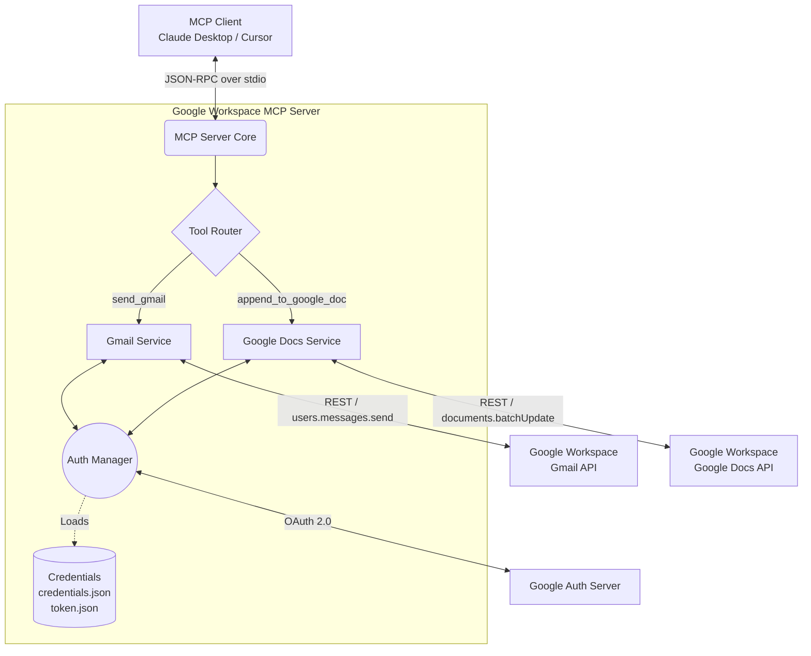
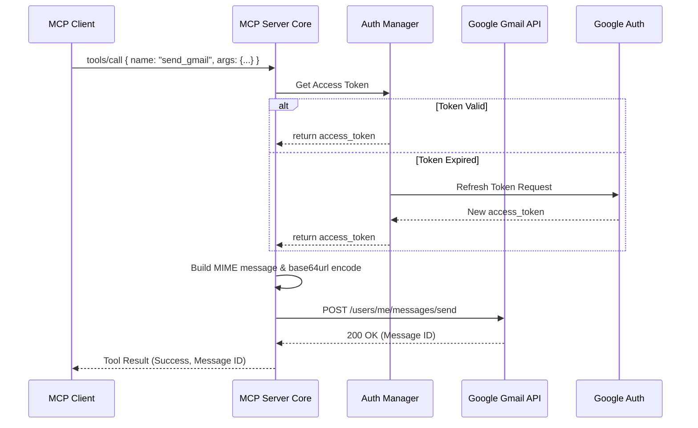

# Architecture: Google Workspace Integration MCP Server

## 1. System Overview
The Google Workspace Integration MCP Server is a local server that exposes specific Google Workspace functionalities (Gmail sending and Google Docs appending) as standardized tools to any Model Context Protocol (MCP) compatible AI agent (e.g., Claude Desktop, Cursor). 

The server acts as a bridge, accepting MCP-formatted JSON-RPC requests via standard input/output (stdio), authenticating with Google Cloud via OAuth 2.0, and translating those requests into Google Workspace API calls.

## 2. High-Level Architecture

## 3. Core Components

### 3.1. MCP Protocol Layer (Transport)
*   **Transport Mechanism:** Standard I/O (stdio). The server communicates with the host application by reading from `stdin` and writing to `stdout`.
*   **Message Format:** JSON-RPC 2.0 as strictly defined by the MCP specification.
*   **Lifecycle Management:** Handles the `initialize` handshake, tool discovery (`tools/list`), and tool execution (`tools/call`).

### 3.2. Server Core & Tool Router
*   **Initialization:** Advertises the available tools (`send_gmail` and `append_to_google_doc`) and their respective JSON schemas during the initial handshake with the MCP client.
*   **Routing:** Intercepts incoming `tools/call` requests, parses the arguments, and routes the request to the appropriate service module.
*   **Error Handling:** Catches API errors, authentication failures, and validation errors. Translates these into graceful MCP tool execution results with `isError: true`, preventing the server process from crashing.

### 3.3. Authentication Module (Auth Manager)
*   **Strategy:** Google OAuth 2.0 (User delegation).
*   **Credential Storage:** Reads `credentials.json` (OAuth client ID/secret) and manages `token.json` (access and refresh tokens).
*   **Token Lifecycle:** Automatically detects expired access tokens and seamlessly requests new ones using the refresh token before executing Google API calls.

### 3.4. API Service Modules
*   **Gmail Service (`send_gmail`):**
    *   Constructs a properly formatted MIME RFC 2822 email message.
    *   Encodes the message in `base64url` format.
    *   Invokes the `gmail.users.messages.send` API endpoint.
*   **Google Docs Service (`append_to_google_doc`):**
    *   Constructs a `documents.batchUpdate` payload containing an `insertText` request.
    *   Targets the end of the document (`index` calculated or omitted if API appends by default, or querying doc length first).

## 4. Sequence Diagrams

### 4.1. Tool Execution: Send Email

## 5. Technology Stack Recommendations

*   **Language:** TypeScript (Node.js) or Python. TypeScript is highly recommended due to the robust `@modelcontextprotocol/sdk` and strongly-typed nature of JSON schemas.
*   **MCP SDK:** `@modelcontextprotocol/sdk` (Node.js) or `mcp` (Python).
*   **Google API Client:** 
    *   Node.js: `googleapis` (contains Auth, Gmail, and Docs clients).
    *   Python: `google-api-python-client`, `google-auth-httplib2`, `google-auth-oauthlib`.

## 6. Security & Permissions

The server operates on the principle of least privilege. The OAuth 2.0 consent screen will only request the exact scopes needed for the two operations:
1.  **Gmail:** `https://www.googleapis.com/auth/gmail.send` - Restricted specifically to sending emails; the server cannot read the user's inbox.
2.  **Google Docs:** `https://www.googleapis.com/auth/documents` - Required to edit documents.

Tokens (`token.json`) must be stored locally in the user's secure environment and excluded from version control (added to `.gitignore`).
